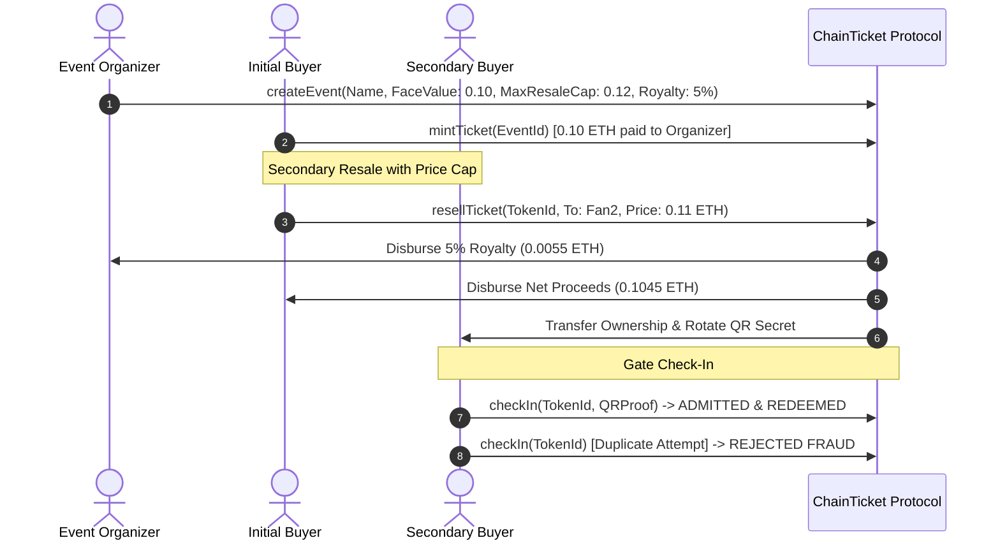

# ChainTicket — Anti-Scalping Web3 NFT Event Ticketing Protocol


ChainTicket is a decentralized NFT event ticketing platform engineered to permanently eliminate predatory secondary ticket scalping, bot gouging, and counterfeit gate fraud. By embedding hard mathematical price ceilings, automated organizer resale royalties, and cryptographically randomized single-use gate admission QR proofs, ChainTicket restores fairness to live concerts, sporting events, and global conferences.

---

## Protocol Lifecycle



---

## Core Innovations

1. **Smart Contract Anti-Scalping Ceilings:** Secondary resale transactions exceeding the organizer's configured maximum markup cap (e.g. max +20%) are unconditionally reverted at the EVM opcode level.
2. **Automated Perpetual Royalties:** Organizers receive secondary sales royalties programmatically distributed upon every valid transfer.
3. **Dynamic QR Cryptographic Rotation:** Whenever a ticket pass is transferred or resold, its internal gate verification hash rotates to prevent previous owners from reusing cloned screenshots.
4. **Gate Admission Verification Console:** Real-time venue entrance scanner interface supporting token ID and security hash verification with fraud alert logging.
5. **Modern Cyberpunk / Violet UI:** Visual design featuring perforation pass motifs, live capacity metrics, and wallet pass management.

---

## Technology Stack

- **Smart Contracts:** Solidity `^0.8.20`, ERC721 NFT principles, EVM Sepolia testnet
- **Backend Service:** Node.js 22, Express.js, native `node:sqlite` (WAL mode)
- **Frontend:** Vanilla JavaScript (ES6+), Neon-accented Modern CSS
- **Testing:** Node.js native test runner (`node:test`, `node:assert/strict`)
- **DevOps:** Docker, Docker Compose, GitHub Actions CI

---

## Local Development & Testing

```bash
# Clone the repository
git clone https://github.com/Soulofghost/chainticket.git
cd chainticket/backend

# Install dependencies
npm install

# Run automated tests
npm test

# Start the server
npm start
```
Visit `http://localhost:4025` to launch the ChainTicket marketplace and gate scanner.

---

## License

SPDX-License-Identifier: MIT  
Copyright (c) 2026 Alvin MS ([@Soulofghost](https://github.com/Soulofghost)).
